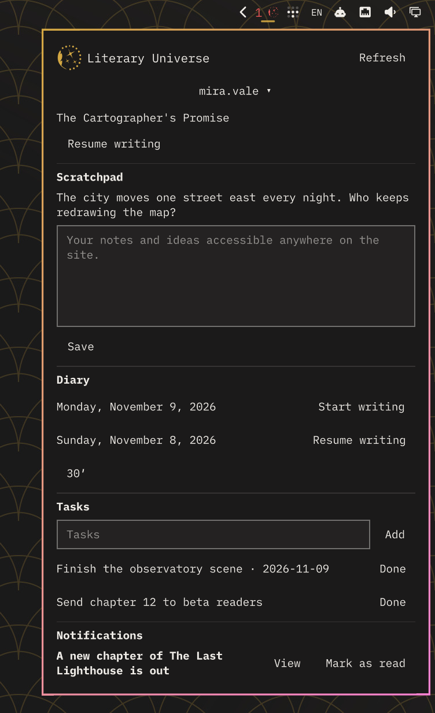

# Literary Universe for Omarchy

Capture ideas, manage personal tasks and return to your writing from the Omarchy bar.



Requires a free [Literary Universe](https://literaryuniverse.com) account.

## Features

- **Scratchpad:** read your latest notes and append a quick capture without replacing existing rich formatting. Draft capture text saves locally as you type. Interrupted submissions retain their operation ID for safe retry.
- **Diary:** start or continue today's and yesterday's entries and receive an optional daily desktop reminder using your LU reminder timezone and hour. Snooze for 30 minutes. Completed days are not reminded.
- **Todos:** add and complete personal tasks using LU's task permissions and subscription rules. The panel shows up to 100 unfinished tasks, ordered by due date.
- **Continue writing:** return to the last story or universe in your LU writing history, using the same destination as your dashboard.
- **Notifications:** see the latest three Novu notifications, open their destinations and mark them read. The bar badge counts unread items among these three. Optional message and release banners respect desktop Do Not Disturb. Banners say only that something new arrived; the text stays in the panel.
- **Account:** see the signed-in username and open its menu to log out.
- **LU blog:** show the latest published article from LU's configured official blog.

## Requirements

Omarchy 4 Quattro with `qs.Commons.Translations` (tested on Omarchy 4.5.0, x86_64).
The helper runs on Node.js 22 or later, found as `node` on the shell's `PATH`.
It also uses `util-linux` (`flock`), `libsecret` (`secret-tool`) with a running
Secret Service such as GNOME Keyring, `xdg-utils` (`xdg-open`) and `libnotify`
(`notify-send`). No npm packages, build step or installation hooks are used.

Check with `node --version` and install Node.js 22 or later if it is missing.

## Installation

```sh
omarchy plugin add https://github.com/LiteraryUniverse/omarchy-literary-universe.git
omarchy plugin enable literaryuniverse.companion
```

To test an unreleased version, clone `main` into a separate directory, review it,
run `omarchy plugin validate` on it, then copy it to
`~/.config/omarchy/plugins/literaryuniverse.companion` and rescan with
`omarchy-shell shell rescanPlugins`. Do not overwrite an existing installation
or unsynced local data.

## Update

```sh
omarchy plugin update literaryuniverse.companion
```

Settings, the keyring login and local drafts are kept across updates.

Click the LU logo and choose **Log in**. Your browser opens LU's OAuth consent
page. The plugin never asks for your LU password. Authentication requests separate permissions:
`companion:read` for reminder status and recent writing; `tasks:read` and
`tasks:write` for personal tasks; `notifications:read` and `notifications:write`
for the inbox and read state; and `scratchpad:read` and `scratchpad:write` for
notes. LU issues rotating refresh tokens for this public client. Diary entry
text is not exposed. Work-restricted and organization credentials are refused.

The panel uses Tab to move between controls, Escape to close and Ctrl+Enter to
submit a capture. This command can be assigned to your preferred keyboard shortcut:

```sh
omarchy-shell shell toggle literaryuniverse.companion '{}'
```

Configure background refresh and the three banner toggles in Omarchy's plugin
settings. Daily diary banners also require reminders to be enabled in LU's diary
settings; their hour and timezone come from LU. Refresh runs once a minute while signed in; banners are off by default.
Turning off background refresh also turns off desktop reminders until re-enabled.
The panel still refreshes when opened. Opening notification preferences in LU
controls the underlying Novu workflows.

## Appearance

The LU logo appears in the bar and panel header. Its silhouette comes from the
official bundled LU mark; its color follows the bar foreground/active color and
panel accent. No logo is fetched from the network.

Colors update live with Omarchy's theme. The panel uses the shell's popup
background and text roles, while controls use its shared accent, borders, focus,
hover and selection styles. The multiline scratchpad editor uses the same
control styling as Omarchy's single-line field, including selected text.
No LU brand colors or Qt default palette are imposed on the desktop.

## Local testing

The helper accepts `LU_COMPANION_URL=http://localhost:4200`. Only HTTPS origins
and HTTP loopback origins are accepted. Restart the test shell with that variable
set; do not change a running production shell just to test. Each origin has a
separate keyring credential and data directory.

```sh
tests/run
omarchy plugin validate .
printf '%s\n' '{"action":"refresh"}' | LU_COMPANION_URL=http://localhost:4200 node src/bridge.mjs
```

`demo/run` retakes `preview.png` from fictional fixtures. It stops the running
shell for about half a minute, loads this checkout's `HEAD` in a demo shell, and
then restores the normal shell, the installed plugin and the workspace.

The JSON helper's `login` action opens the browser. Its output contains UI data or
an error code, never credentials. Use the panel for normal interaction.

## Privacy and removal

The plugin talks only to `literaryuniverse.com` (or the loopback origin you set
for testing) and, for the cover of your latest work, the HTTPS address LU gives
for that cover. The helper downloads it with size and dimension limits and the
panel shows the local copy.

Tokens live in the OS keyring under `literary-universe-omarchy`. Capture drafts
are stored per account under `$XDG_STATE_HOME/literary-universe-omarchy` (default
`~/.local/state/literary-universe-omarchy`), with private directory/file permissions.
Drafts are plaintext, so disk encryption remains relevant. They survive logout
and removal to avoid losing unsent writing; another account cannot see them in
the panel. The plugin adds no analytics.

**Log out** revokes the refresh token before clearing the local credential.
If LU cannot be reached, retry logout when connected, or revoke the grant in LU's
Integrations settings. Removing the plugin alone does not revoke the grant.

To remove everything, log out first, then remove the plugin and its local state:

```sh
omarchy plugin remove literaryuniverse.companion
rm -rf "${XDG_STATE_HOME:-$HOME/.local/state}/literary-universe-omarchy"
```

Export or submit any unsent capture before deleting the local state.
Legacy scratchpads with HTML but no editor document must first be saved in LU's
web editor. The desktop appends notes; full rich-text editing stays on the website.

## Support and security

Report bugs and ask questions in [GitHub issues](https://github.com/LiteraryUniverse/omarchy-literary-universe/issues).
Report security problems privately to security@literaryuniverse.com, not in a public issue.

## Contributing and publishing

See [the release checklist](docs/releasing.md), [the changelog](CHANGELOG.md) and [the API contract](docs/api.md).
The UI follows Omarchy's shared controls, palette and locale. The multiline field
uses Qt Quick Controls because Omarchy has no multiline editor. The 50 locale
catalogs are bundled and can be corrected through pull requests.

MIT license. The OAuth loopback flow follows the MIT-licensed
[Literary Universe CLI](https://github.com/LiteraryUniverse/cli).
